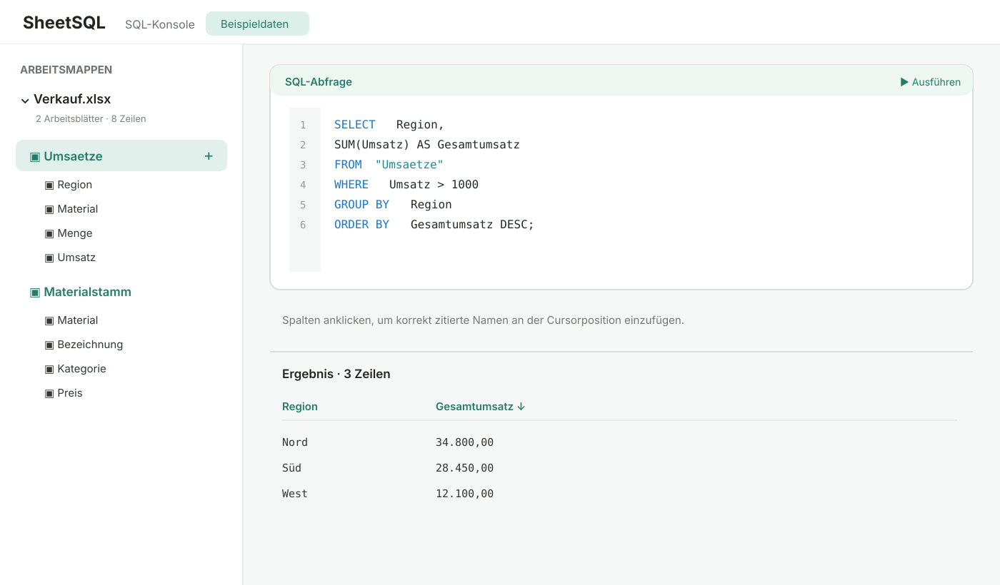
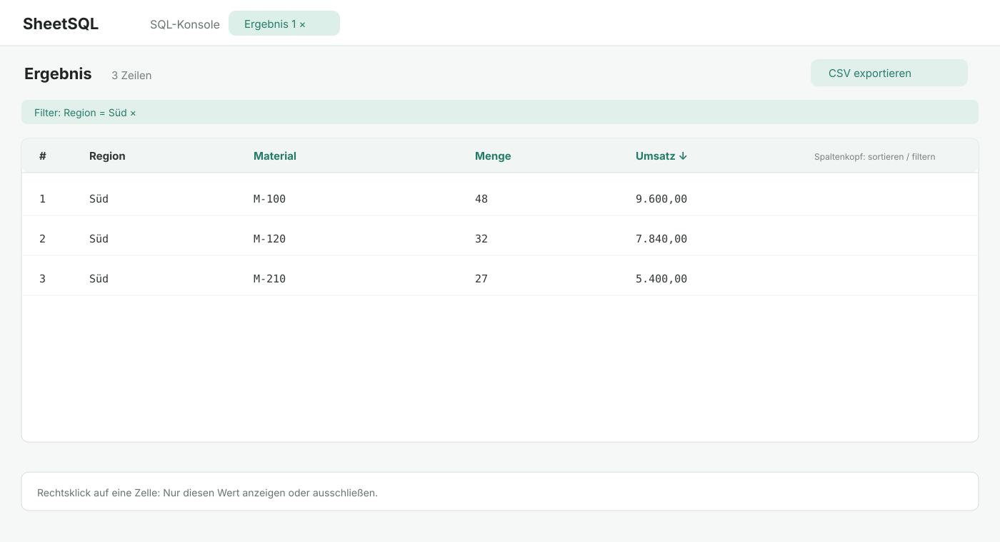

# SheetSQL

Lokale macOS-App für SQL-Analysen über Excel-Arbeitsmappen. SwiftUI, native Ergebnistabelle und SQLite im Arbeitsspeicher; keine externen Pakete, kein Server und keine Uploads. Separates Projekt neben Nori.

## Starten

macOS 14 oder neuer und Xcode/Swift 6 zum Bauen:

```sh
./scripts/build-app.sh
open output/SheetSQL.app
```

Mit „Excel-Datei öffnen“ eine oder mehrere `.xlsx`-/`.xlsm`-Dateien importieren oder mit den eingebauten Beispieldaten starten. Beim Import eigener Dateien beginnt die SQL-Konsole leer; die Beispieldaten enthalten weiterhin eine vorbereitete Abfrage. Ein Klick auf einen Blattnamen wählt dessen Datei aus. Ein Klick auf eine aufgeklappte Spalte fügt ihren korrekt zitierten Namen an der Cursorposition ein oder ersetzt die Textauswahl. Eine Vorschau lässt sich ausdrücklich über das Kontextmenü eines Arbeitsblatts als SQL-Abfrage einsetzen.

`⌘O` öffnet Dateien, `⌘Return` führt SQL aus. `⇧⌘W`, „Ausgewählte Excel-Datei schließen“ im Dateimenü oder „Datei schließen“ im Kontextmenü entfernen sämtliche Blätter dieser Datei aus der Sitzung. Die Quelldatei bleibt unverändert. SQL und Verlauf bleiben erhalten; die Ergebnisansicht wird beim Schließen geleert. Nach dem Schließen der letzten Datei erscheint wieder der Startbildschirm.

## Screenshots

Die folgenden Ansichten verwenden ausschließlich synthetische Beispieldaten. Sie zeigen den typischen Ablauf: Tabellen und Spalten auswählen, SQL ausführen und das Ergebnis anschließend sortieren, filtern oder exportieren.



*SQL-Konsole: `Umsaetze` und `Materialstamm` stehen als Tabellen bereit; die Abfrage gruppiert Umsätze nach Region.*



*Ergebnisansicht: Die Umsatzspalte ist absteigend sortiert, der Regionsfilter ist oberhalb der Tabelle sichtbar.*

## SQL

Jedes nicht leere Arbeitsblatt wird zu einer Tabelle. Die erste befüllte Zeile liefert die Spaltennamen. Leere oder doppelte Namen werden ergänzt; gleichnamige Blätter erhalten einen Suffix. Die Seitenleiste zeigt die tatsächlich verwendeten Namen.

```sql
SELECT Region, SUM(Umsatz) AS Gesamtumsatz
FROM "Umsaetze"
GROUP BY Region
ORDER BY Gesamtumsatz DESC;
```

JOINs funktionieren auch über Blätter aus verschiedenen Dateien. Unterstützt werden SQLite-SELECTs inklusive CTEs und Fensterfunktionen. Abfragen verändern weder Tabellen noch Quelldateien. Textwerte mit führenden Nullen bleiben Text; echte Excel-Zahlen werden numerisch gespeichert. NULL kennzeichnet leere Zellen.

## SQL-Beispiele

Tabellen- und Spaltennamen werden in doppelte Anführungszeichen gesetzt. Textwerte verwenden einfache Anführungszeichen. Die Namen entsprechen den Tabellen und Spalten aus der Seitenleiste.

### Filtern und sortieren

```sql
SELECT "Material", "Menge", "Region"
FROM "Data"
WHERE "Region" = 'Süd'
  AND "Menge" > 10
ORDER BY "Menge" DESC;
```

### Aggregieren

```sql
SELECT "Region",
       COUNT(*) AS "Anzahl",
       SUM("Umsatz") AS "Gesamtumsatz"
FROM "Umsaetze"
GROUP BY "Region"
HAVING SUM("Umsatz") > 10000
ORDER BY "Gesamtumsatz" DESC;
```

### JOIN über zwei Arbeitsblätter

```sql
SELECT a."Material",
       a."Menge",
       b."Bezeichnung"
FROM "Bestand" AS a
LEFT JOIN "Materialstamm" AS b
  ON a."Material" = b."Material"
WHERE a."Menge" > 0;
```

`INNER JOIN` liefert nur passende Datensätze. `LEFT JOIN` behält alle Zeilen der linken Tabelle und liefert bei fehlenden Treffern NULL in den Spalten der rechten Tabelle.

### CTE für eine lesbare Zwischentabelle

```sql
WITH regionale_umsatz AS (
    SELECT "Region", SUM("Umsatz") AS "Umsatz"
    FROM "Umsaetze"
    GROUP BY "Region"
)
SELECT "Region", "Umsatz"
FROM regionale_umsatz
WHERE "Umsatz" >= 20000
ORDER BY "Umsatz" DESC;
```

### Mehrere CTEs und Fensterfunktion

```sql
WITH artikel AS (
    SELECT "Material", SUM("Menge") AS "Menge"
    FROM "Bestand"
    GROUP BY "Material"
), gerankt AS (
    SELECT "Material", "Menge",
           ROW_NUMBER() OVER (ORDER BY "Menge" DESC) AS "Rang"
    FROM artikel
)
SELECT *
FROM gerankt
WHERE "Rang" <= 10;
```

CTEs beginnen mit `WITH` und stehen vor dem eigentlichen `SELECT`. Sie helfen, komplexe Abfragen in benannte, nacheinander lesbare Schritte zu zerlegen.

## Seitenleiste

Die Seitenleiste gruppiert Arbeitsblätter nach Excel-Datei. Ein Klick auf den Namen eines Arbeitsblatts öffnet ein Menü mit „SELECT-Anweisung erstellen“, „Tabellenname einfügen“, „Tabellenname kopieren“ und „Editor öffnen“. Das `+` daneben fügt den korrekt zitierten Tabellennamen direkt an der Cursorposition ein.

Ein Klick auf eine Spalte öffnet „Spaltenname einfügen“ und „Spaltenname kopieren“; ihr `+` fügt den korrekt zitierten Spaltennamen unmittelbar ein. Das `×` rechts am Dateinamen schließt sämtliche Arbeitsblätter dieser Datei aus der Sitzung, ohne die Quelldatei zu verändern.

## Grenzen der ersten Version

- Kein altes `.xls`, `.xlsb`, kein Kennwortschutz. In Excel als unverschlüsselte `.xlsx` speichern.
- Formeln werden nicht berechnet; importiert wird der gespeicherte Ergebniswert. Fehlt dieser, wird NULL importiert. Makros werden nicht ausgeführt.
- Übliche Datumsformate werden zu ISO-Zeitstempeln konvertiert (1900/1904-System). Spezielle benutzerdefinierte Formate, reine Uhrzeiten und Zeitdauern sind noch nicht vollständig abgedeckt. Formatierung und verbundene Zellen werden nicht übernommen.
- Erste befüllte Zeile als Kopfzeile; keine konfigurierbare Kopfzeile oder Typkorrektur. Vollständig leere Zeilen werden übersprungen.
- Ergebnisse und CSV-Export sind auf 10.000 Zeilen begrenzt, mit sichtbarem Hinweis. Vorschauen fragen 1.000 Zeilen ab. Rechenintensive SQL-Abfragen werden nach ungefähr 10 Sekunden abgebrochen.
- Import und Datenbank liegen im RAM; für kleine bis mittlere Dateien gedacht, noch kein Benchmark für große Arbeitsmappen. Der Import verwendet den macOS-ZIP-Reader.
- Dateien und Abfrageverlauf bleiben nur während der Sitzung erhalten.
- CSV-Export enthält die Originalwerte, einschließlich Text, der in Excel als Formel interpretiert werden könnte.
- Lokal ad-hoc signiert, noch kein notarisiertes Distributionspaket.

## Tests

```sh
CLANG_MODULE_CACHE_PATH=/tmp/sheetql-clang-cache \
SWIFTPM_MODULECACHE_OVERRIDE=/tmp/sheetql-swift-cache \
swift test --disable-sandbox
```

Die Tests prüfen XLSX mit Shared Strings, Inline Strings, Leerzellen, doppelten Überschriften, Datum und Formel-Cache sowie JOINs, Aggregate, führende Nullen, SQL-Schreibschutz, Ergebniskappung und CSV-Escaping.

## Ergebnisse sortieren und filtern

Ein Klick auf einen Spaltenkopf öffnet ein Menü für auf-/absteigende Sortierung sowie Text- und NULL-Filter. Rechtsklick auf eine Ergebniszelle wählt die Zeile aus und bietet „Nur diesen Wert anzeigen“ und „Diesen Wert ausschließen“. Verglichen wird der Wert der angeklickten Spalte. Pro Spalte gilt ein Filter; Filter verschiedener Spalten werden mit UND kombiniert. Exakte Filter unterscheiden Groß-/Kleinschreibung und NULL von leerem Text; „Enthält“ ignoriert Groß-/Kleinschreibung.

Aktive Filter erscheinen oberhalb der Tabelle und lassen sich einzeln oder zusammen mit der Sortierung zurücksetzen. Numerische SQL-Spalten werden numerisch sortiert. Der CSV-Export verwendet die sichtbare gefilterte und sortierte Ansicht. Eine neue erfolgreiche SQL-Abfrage setzt die Ansichtsfilter zurück. Das SQL im Editor bleibt beim Sortieren und Filtern unverändert.

Die Ansichtsfilter gelten ausschließlich für die bereits geladenen Ergebniszeilen (maximal 10.000), nicht für weitere Zeilen der Quelldatei. Für Analysen der gesamten Tabelle WHERE und ORDER BY in SQL verwenden.

## SQL-Dateien und Ergebnis-Tabs

SQL-Dateien über das Dateimenü oder die Ordner-Schaltfläche im Editor laden (`⇧⌘O`). Speichern mit `⌘S`, Speichern unter mit `⇧⌘S`. Dateien werden als UTF-8 mit Endung `.sql` gespeichert. Beim Laden wird eine geänderte Abfrage erst nach Speichern oder ausdrücklichem Verwerfen ersetzt; Laden führt keine Abfrage aus. Der Dateiname und ein Punkt für ungespeicherte Änderungen erscheinen über dem Editor.

„In neuem Tab“ im Ergebnisbereich (auch `⌥⌘T`) legt eine Kopie des Ergebnisses mit den aktuellen Filtern und der Sortierung an. Weitere Abfragen aktualisieren nur „Aktuelles Ergebnis“. Jeder aufbewahrte Tab hat eigene Filter und eine eigene Sortierung; CSV exportiert den ausgewählten Tab. Über × wird ein Tab geschlossen. Die ursprüngliche Abfrage erscheint als Tooltip des Tabnamens. Tabs bleiben auch beim Schließen der Excel-Quelldatei verfügbar, werden aber beim Beenden der App nicht gespeichert.

Ergebnis-Tabs erscheinen oben im Arbeitsbereich. Beim Auswählen eines Ergebnis-Tabs entfallen SQL-Editor und Begrüßungskopf, sodass die Tabelle die gesamte verfügbare Höhe nutzt. „SQL-Konsole“ bringt Editor und aktuelles Ergebnis zurück; Text und Cursorposition bleiben erhalten. Sortieren, Filtern und Exportieren sind auch in der großen Tabellenansicht verfügbar.
